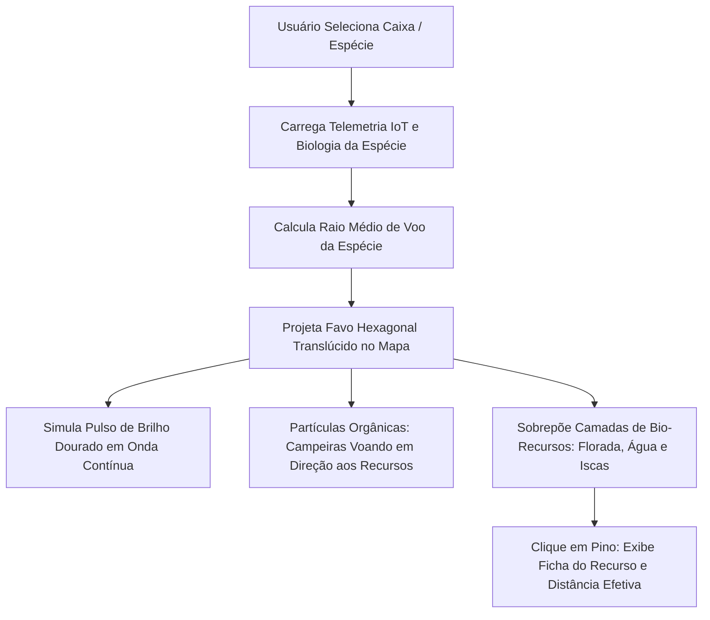

# 🐝 MELIPONA HEX — Ecossistema Digital de Meliponicultura 4.0
### Documentação Técnica de Arquitetura de Informação, UI/UX Design System e Implementação Full-Stack

---

## 1. Visão Geral do Produto e Objetivos
O **MELIPONA HEX** é um ecossistema digital multiplataforma (Web & Mobile) desenvolvido especificamente para a **Meliponicultura** — a criação técnica e conservação das Abelhas Nativas Sem Ferrão (ASF) do Brasil (gêneros *Melipona*, *Tetragonisca*, *Plebeia*, *Scaptotrigona*, etc.).

O sistema une a sabedoria biológica ancestral da floresta à tecnologia de ponta (Georreferenciamento Vetorial, Telemetria IoT, Biometria de Colmeias e Simulação de Enxames).

---

## 2. Identidade Visual & Design System "HexaBio"

### 2.1 Paleta de Cores
| Nome do Token | Valor Hex | Aplicação Principal |
| :--- | :--- | :--- |
| **Golden Honeycomb (Primária)** | `#FFC300` | Botões de ação, contorno pulsante do Hex-Radar, indicadores de status ativo |
| **Favo Âmbar Dourado** | `#F4B41A` | Gradientes, cartões em destaque, destaques métricos |
| **Âmbar Mel Profundo** | `#D49500` | Bordas secundárias, sombras de gota de mel |
| **Preto Carvão Profundo (Dark Canvas)** | `#0D0F12` | Fundo principal da aplicação no Modo Escuro |
| **Grafite Biológico (Surface Card)** | `#14171E` | Superfícies flutuantes, cards de colmeia e modais |
| **Borda Hexagonal Translúcida** | `rgba(255, 195, 0, 0.22)` | Contornos com brilho orgânico |
| **Off-White Própolis (Light Canvas)** | `#FBFBFA` | Fundo em Modo Claro, garantindo respiro e contraste |

### 2.2 Cores Bio-Funcionais (Recursos do Mapa)
- 🌸 **Florada Néctar / Pólen**: `#FF5C8A` (Rosa floração nativa)
- 💧 **Água Mineral / Bebedouros Seguros**: `#38BDF8` (Azul celeste)
- 🍯 **Iscas-PET & Potenciais Ocos**: `#A855F7` (Roxo atrativo)
- ⚠️ **Risco Sanitário / Inimigos**: `#EF4444` (Vermelho alerta - forídeos, formigas, agrotóxicos)

### 2.3 Tipografia
- **Títulos e Métricas:** `Poppins` ou `Quicksand` (pesos 700 e 800) — traz calor, modernidade e formas arredondadas.
- **Blocos de Texto e Dados Técnicos:** `Inter` (pesos 400, 500 e 600) — legibilidade máxima em telas pequenas e ambientes de campo sob luz solar.
- **Telemetria e Geometria:** `JetBrains Mono` — para distâncias (metros), coordenadas e temperaturas.

### 2.4 Geometria Hexagonal
Abandono radical de retângulos ortogonais puros em favor de polígonos hexagonais:
- Máscara CSS: `clip-path: polygon(50% 0%, 100% 25%, 100% 75%, 50% 100%, 0% 75%, 0% 25%);`
- Intersecções orgânicas em favo nos grids de dashboards e cartões flutuantes.

---

## 3. Funcionalidade Core: "Hex-Radar"

### 3.1 Conceito e Interação
Ao invés do raio circular tradicional de GPS, o sistema projeta um **radar em favo hexagonal translúcido e pulsante** centrado nas coordenadas geográficas da colmeia.

### 3.2 Raio Efetivo de Forrageamento por Espécie
| Espécie | Nome Científico | Raio de Voo Padrão | Área de Cobertura | Comportamento de Coleta |
| :--- | :--- | :--- | :--- | :--- |
| **Jataí** | *Tetragonisca angustula* | **~500 m** | ~0.65 km² | Voo rápido, explora quintais urbanos e jardins |
| **Mirim Droryana** | *Plebeia droryana* | **~400 m** | ~0.41 km² | Coleta próxima, muito sensível a ventos fortes |
| **Mandaçaia** | *Melipona quadrifasciata* | **~1.500 m** | ~5.84 km² | Voa em dosséis altos, busca árvores nativas robustas |
| **Uruçu Amarela** | *Melipona flavolineata* | **~2.000 m** | ~10.39 km² | Grande porte, visita flores em raios florestais amplos |
| **Tiúba** | *Melipona fasciculata* | **~2.200 m** | ~12.57 km² | Forrageamento vigoroso mesmo sob alta umidade |

### 3.3 Efeitos Sensoriais & Partículas
- **Glowing Honey Perimeter:** Contorno vetorial animado com `shadowBlur` e interpolação senoidal, simulando respiração do ninho.
- **Swarm Physics (Dança das Abelhas):** Partículas com curva senoidal lateral (*wobble*) que se deslocam da colmeia até os focos de néctar e retornam com ponto de luz dourada ampliada (indicando cesto de pólen carregado).
- **Alerta de Vento e Clima:** Se a temperatura ambiente for inferior à atividade mínima da espécie (<18°C), o favo do radar adquire contorno sutilmente azulado/inativo, indicando "Colmeia em recolhimento térmico".

---

## 4. Estrutura do Ecossistema (Telas & Fluxos)

### 4.1 Dashboard Inicial (Visão do Meliponário)
- Cards flutuantes com resumo climático em tempo real.
- Status biométrico médio das caixas: temperatura de ninho (sensor DS18B20/SHT31), umidade relativa e peso por célula de carga.
- Acesso de 1 toque para o Hex-Radar.

### 4.2 Catálogo Nativo (Enciclopédia Visual 3D)
- Cards com efeito de giroscópio no celular (3D tilt no mouse em desktop).
- Detalhes de arquitetura de ninho (invólucro de cerume, lamelas de pólen, potes de mel verticais/ovais).
- Modelo de caixa ideal (Padrão INPA, Baiano, Modular Nordestino) com medidas em centímetros.
- Ação direta: **"Projetar no Hex-Radar"** que ajusta o mapa na hora para o raio da abelha escolhida.

### 4.3 Diário de Manejo e Gestão
- Registro rápido em menos de 10 segundos:
  - **Alimentação:** Xarope de açúcar invertido (1:1), chás florais ou bombom de pólen fermentado.
  - **Divisão de Enxames:** Método 1:1, 2:1 ou troca de campeiras.
  - **Colheita de Mel:** Registro de kg/litros colhidos com sucção a vácuo sanitária.
  - **Revisão e Sanidade:** Controle de forídeos (*Pseudohypocera kerteszi*) com iscas de vinagre de maçã.

### 4.4 Mercado e Comunidade Sustentável
- Venda e troca de enxames matrizes certificados com selo ambiental SISPASS / CTF IBAMA.
- Caixas racionais em madeira certificada (cedro, canafístula, garapeira).
- Troca de pólen e atrativos feromonados entre criadores da mesma bacia hidrográfica.

---

## 5. Como Executar e Testar o Protótipo Interativo
1. Abra o arquivo [index.html](file:///c:/Users/Cyberaosf/Desktop/ProjetoMeliponicultura/index.html) diretamente no seu navegador (Google Chrome, Microsoft Edge, Firefox, Safari) ou em um emulador mobile.
2. Interaja com o **Hex-Radar**:
   - Troque entre as abelhas (Mandaçaia, Jataí, Uruçu, Tiúba, Mirim) e observe a adaptação imediata do favo e da área de cobertura.
   - Clique nos ícones de floradas, bebedouros e iscas no radar para abrir a ficha de campo.
   - Ative/desative camadas e ajuste o zoom.
   - Clique em **"+ Novo Manejo"** para registrar uma intervenção e ver a timeline ser atualizada em tempo real.
