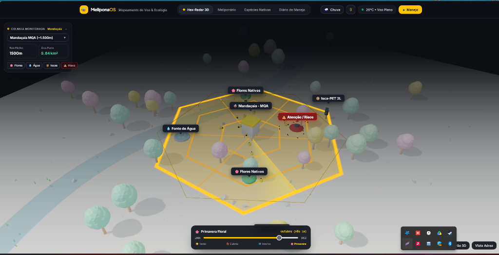

# 🐝 MELIPONA OS — Mapeamento de Voo & Ecologia das Abelhas Nativas

<p align="center">
  
</p>

<p align="center">
  <strong>Ecossistema inteligente para criação técnica, mapeamento ecológico 3D e preservação das Abelhas Nativas Sem Ferrão (ASF).</strong>
</p>

<p align="center">
  
  
  
  
</p>

---

## 🍯 Sobre o MeliponaOS

O **MeliponaOS** une biologia comportamental e tecnologia espacial interativa para a Meliponicultura 4.0. Dedicado ao manejo racional de espécies de Abelhas Nativas Sem Ferrão (ASF) brasileiras, tais como **Mandaçaia (MQA)**, **Jataí**, **Uruçu**, **Tiúba** e **Mirim**.

A plataforma integra:
1. **Aba Inicial Informativa:** Apresentação completa dos propósitos do sistema, pilares ecológicos e benefícios da criação de abelhas nativas para a conservação da biodiversidade.
2. **Hex-Radar 3D Interativo:** Simulação tridimensional do ninho, malha poligonal com raios de forrageamento, marcadores botânicos de floradas nativas, fontes de água, iscas-PET e alertas de risco sanitário.
3. **Visão do Meliponário:** Biometria, pesagem contínua e status ambiental das caixas racionais.
4. **Espécies Nativas:** Catálogo com fichas biológicas e especificações técnicas de caixas padrão INPA.
5. **Diário de Manejo:** Registro rápido de alimentação, divisões, colheitas sustentáveis e revisões sanitárias.

---

## ✨ Recursos da Aplicação

### 🌐 1. Hex-Radar 3D & Mapeamento Ecológico
- **Relevo 3D Interativo:** Visualização em perspectiva do terreno, árvores e entorno do meliponário.
- **Raio de Voo Racional:** Projeção da área de cobertura em favo poligonal ajustada automaticamente para a espécie monitorada.
- **Pinos de Campo:**
  - 🌸 **Flores Nativas:** Mapeamento botânico de pasto meliponícola.
  - 💧 **Fontes de Água:** Pontos de hidratação e umidade seguros.
  - 🍯 **Iscas-PET 2L:** Acompanhamento de ninhos-isca e captura ética.
  - ⚠️ **Atenção / Risco:** Zonas de perigo químico (agrotóxicos) ou ataques biológicos (forídeos).

### ☀️ 2. Linha do Tempo e Condições Climáticas
- Slider sazonal (Janeiro a Dezembro) com transição de estações (*Verão, Outono, Inverno, Primavera Floral*).
- Simulação de clima dinâmico com alternância de chuvas e monitoramento de temperatura ambiente.

---

## 🚀 Como Executar Localmente

### Pré-requisitos
- Qualquer navegador web atualizado (Chrome, Edge, Firefox, Safari).
- PowerShell no Windows ou terminal Unix.

### Inicialização Rápida

1. **Clone o repositório:**
   ```bash
   git clone https://github.com/MarcosAosf/ProjetoMeliponicultura.git
   cd ProjetoMeliponicultura
   ```

2. **Inicie o servidor HTTP:**
   - Execute o script PowerShell incluído:
     ```powershell
     powershell -ExecutionPolicy Bypass -File .\serve.ps1
     ```
   - Ou abra o arquivo `index.html` diretamente no navegador.

3. **Acesse:**
   - Abra [http://localhost:8080/](http://localhost:8080/) no seu navegador.

---

## 🐝 Espécies e Raios de Forrageamento

| Espécie | Nome Científico | Raio Médio | Área de Cobertura |
| :--- | :--- | :--- | :--- |
| **Jataí** | *Tetragonisca angustula* | ~500 m | ~0.65 km² |
| **Mirim Droryana** | *Plebeia droryana* | ~400 m | ~0.41 km² |
| **Mandaçaia** | *Melipona quadrifasciata* | ~1.500 m | ~5.84 km² |
| **Uruçu Amarela** | *Melipona flavolineata* | ~2.000 m | ~10.39 km² |
| **Tiúba** | *Melipona fasciculata* | ~2.200 m | ~12.57 km² |

---

<p align="center">
  Feito com 💛 e dedicação à preservação das abelhas nativas do Brasil.
</p>
