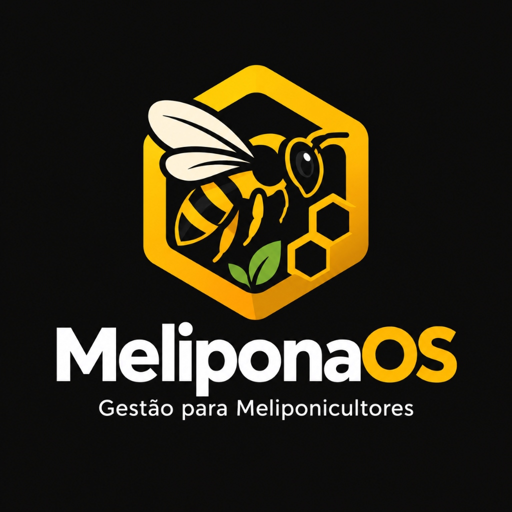

# 🐝 MeliponaOS — Plataforma de Gestão, Mapeamento e Ecologia para Meliponicultura

  

  <strong>O Sistema Operacional Inteligente para Criadores de Abelhas Nativas Sem Ferrão (ASF)</strong> 
  <em>Mapeamento via Satélite em Tempo Real • Alcance Biológico • Simulador 3D WebGL • Telemetria • PWA Offline • Firebase Cloud</em>

  
  
  

---

## 📸 Interface e Demonstração do Sistema

Abaixo a demonstração da interface principal com o **Mapeamento via Satélite Real (Esri WorldImagery)**, anéis dinâmicos de forrageamento biológico georreferenciados e a gaveta lateral de inspeção e biometria em ação:

  

  <em>Mapeamento de colmeias em alta definição com alcance real em metros, controle de ninhos-isca e fotos georreferenciadas.</em>

---

## 🌿 Visão Geral do Projeto

O **MeliponaOS** é uma aplicação web progressiva (PWA) de alta performance projetada para apoiar meliponicultores, biólogos e entusiastas da conservação ambiental no manejo científico de abelhas nativas brasileiras sem ferrão. 

A plataforma divide de forma limpa o uso **prático de campo** (satélite de alta resolução com GPS de alta precisão e câmera) da **simulação científica 3D** (Three.js WebGL com dinâmica climática e biomas sazonais).

---

## 🚀 Principais Módulos & Funcionalidades

### 🛰️ 1. Mapa do Meliponário em Satélite Real (`Leaflet.js` + `Esri WorldImagery`)
- **Imagens Reais de Alta Resolução**: Permite identificar árvores, estradas, divisas e construções rurais com dados cartográficos oficiais.
- **Geolocalização Automática & Fallback Silencioso**: Centraliza o satélite instantaneamente nas coordenadas GPS reais do criador de campo (ou por geolocalização aproximada por IP se o GPS for bloqueado, sem alertas invasivos).
- **Busca Global de Endereços**: Campo integrado com o OpenStreetMap Nominatim para navegar instantaneamente digitando o nome do município, bairro ou coordenada.
- **Alcance Real Biológico de Voo (em Metros Reais)**:
  - Desenha círculos precisos na escala do satélite baseados na fisiologia de cada espécie:
    - *Mirim Droryana*: **400m**
    - *Jataí Dourada*: **500m**
    - *Iraí*: **600m**
    - *Manduri*: **1.000m**
    - *Borá*: **1.200m**
    - *Mandaçaia MQA*: **1.500m**
    - *Bugia*: **1.800m**
    - *Uruçu Amarela*: **2.000m**
    - *Uruçu Nordestina*: **2.000m**
    - *Tiúba / Uruçu-Cinzenta*: **2.200m**
    - *Ninhos-Isca PET*: **120m** (alcance feromonado em círculo tracejado verde).
  - **Enquadramento Dinâmico com `fitBounds`**: Ao trocar a espécie de uma caixa (ex: de Jataí para Uruçu), o raio cresce em tempo real e a câmera se afasta automaticamente para mostrar o diâmetro inteiro do pasto.
  - **Botão Liga/Desliga de Raios**: Oculte ou mostre os perímetros amarelos com 1 clique para manter o mapa limpo quando houver muitos enxames concentrados.

### 📋 2. Diário Técnico de Manejo com Persistência Permanente
- **Registro de Manejos em Campo**: Cadastro ágil de manutenções com seleção da colmeia alvo (`MQA-04`, `JTF-12`, `URA-02` ou qualquer caixa ativa no mapa).
- **Categorias Técnicas**:
  - 💧 *Alimentação Suplementar*: Xarope 1:1, bombom de pólen e reforço proteico.
  - 🍯 *Colheita Sanitária de Mel*: Registro de pesagem, umidade e uso de sugador a vácuo.
  - 🐝 *Divisão de Enxame*: Multiplicação por módulos, discos maduros e realeiras.
  - 🔍 *Revisão Geral e Biometria*: Vigor da rainha, espaço útil e postura.
  - 📦 *Transferência de Ninho-Isca*: Conversão de garrafa PET para caixa racional INPA.
- **Persistência Imediata no Navegador (`LocalStorage`)**: Os registros permanecem salvos mesmo ao recarregar ou fechar a página.
- **Espelho Automático na Nuvem (`Firebase Firestore`)**: Sincronização em tempo real quando o meliponicultor estiver autenticado.

### 📷 3. Rastreabilidade Física e Bilhete de Identidade com Câmera
- **Fotos Reais Comprimidas**: Fotografe caixas e árvores com a câmera do celular (`capture="environment"`). As imagens são otimizadas via `<canvas>` (700px, JPEG 0.7) para economizar dados e funcionar rápido até no 3G/4G rural.
- **Categorias de Foto**: Organize fotos por *"Local/Árvore"*, *"Entrada/Pito"* e *"Disco de Cria/Interno"*.
- **Etiqueta QR Code**: Gere códigos QR individuais de alta resolução prontos para imprimir e colar nas caixas físicas em campo.
- **Rota GPS Automática**: Botão que abre a rota passo a passo até a caixa direto no Google Maps.
- **Gestão de Vigor & Revisão (>90 dias)**:
  - Avaliação de força: **🟢 Forte**, **🟡 Médio** ou **🔴 Fraco**.
  - Alerta automático em vermelho caso uma colmeia esteja há mais de 90 dias sem revisão.
  - Botão *"✍️ Revisar Hoje"* que registra o manejo instantaneamente no diário.

### 🎮 4. Simulador 3D de Voo & Ecologia (Three.js WebGL)
- Localizado na aba **"Espécies Nativas"**, sob a enciclopédia biológica.
- **Botão "Mapear no Radar 3D 🎯"**: Presente em todos os 10 cards das abelhas. Ao clicar, a página rola suavemente até o simulador, seleciona a abelha e dá um flash luminoso na borda.
- **Dinâmica Procedural**: Movimentação individual de campeiras, oscilação de asas, bebedouro de água e árvores nativas.
- **Controle de Chuva & Clima**: Botão integrado de simulação de chuva/tempestade e ciclo de estações do ano (*Primavera Floral*, *Verão*, *Outono*, *Inverno*).

### ⚖️ 5. Comparador Biológico de Espécies
- Modal interativo para comparar lado a lado quaisquer 2 espécies das 10 catalogadas.
- Métricas analisadas: Nome científico, raio de voo no satélite, área de pasto em km², produção anual de mel, modelo de caixa ideal (INPA), docilidade/defesa e grau de dificuldade.

### 🌦️ 6. Alertas Climáticos Preventivos
- Análise meteorológica dinâmica no topo da Dashboard para proteger colmeias contra frentes frias bruscas, tempestades e risco de forídeos.

### 🎨 7. Relatório Visual em Canvas & Compartilhamento no WhatsApp
- **Gerador de Imagem (PNG 1200x680)**: Cria dinamicamente um card institucional elegante contendo o logotipo oficial, total de colmeias ativas, ninhos-isca e inventário por espécie.
- **Compartilhamento WhatsApp**: Dispara uma mensagem pronta formatada com o balanço do meliponário e convite para outros criadores.

### ✉️ 8. Canal de Contato Integrado com Conta Logada
- Modal rápido de contato acessível tanto no menu desktop quanto no mobile.
- Detecta automaticamente a conta do usuário logado (Google / E-mail / Modo Demo) e envia diretamente para o desenvolvedor (`marcosaosf2010@gmail.com`).
- Dispara via **Webmail Gmail** para dispensar clientes de e-mail de desktop (como Outlook do Windows), com fallback universal.

### 🔐 9. Login Seguro e Nuvem (Firebase Auth + Cloud Firestore)
- **Login com Google com 1 clique** ou via e-mail e senha.
- **Modo Demonstração Instantâneo**: Permite testar todos os recursos na nuvem sem precisar cadastrar senhas.
- **Sincronização Bidirecional**: Colmeias, coordenadas, fotos e diário de manejo espelhados no Firestore.

---

## 🐝 Espécies Catalogadas no Sistema

| Espécie | Nome Científico | Raio de Voo | Modelo de Caixa | Produção Anual |
| :--- | :--- | :---: | :---: | :---: |
| **Mirim Droryana** | *Plebeia droryana* | 400m | INPA 10x10 cm | 0.2 a 0.5 kg |
| **Jataí Dourada** | *Tetragonisca angustula* | 500m | INPA 12x12 cm | 0.5 a 1.2 kg |
| **Iraí** | *Nannotrigona testaceicornis* | 600m | INPA 12x12 cm | 0.3 a 0.8 kg |
| **Manduri** | *Melipona marginata* | 1.000m | INPA 15x15 cm | 1.0 a 2.0 kg |
| **Borá** | *Tetragona clavipes* | 1.200m | INPA 18x18 cm | 2.0 a 4.0 kg |
| **Mandaçaia MQA** | *Melipona quadrifasciata* | 1.500m | INPA 20x20 cm | 1.5 a 2.5 kg |
| **Bugia** | *Melipona mandacaia* | 1.800m | INPA 20x20 cm | 1.5 a 3.0 kg |
| **Uruçu Amarela** | *Melipona flavolineata* | 2.000m | INPA 20x20 cm | 3.0 a 6.0 kg |
| **Uruçu Nordestina** | *Melipona scutellaris* | 2.000m | INPA 20x20 cm | 4.0 a 10.0 kg |
| **Tiúba / Cinzenta** | *Melipona compressipes* | 2.200m | INPA 22x22 cm | 5.0 a 12.0 kg |

---

## 🛠️ Tecnologias Utilizadas

- **Frontend Core**: HTML5 Semântico, CSS3 Moderno, JavaScript ES6+ Vanilla.
- **Estilização & Design**: Tailwind CSS (via CDN) com suporte total a **Dark Mode** e paleta **Mel & Favo**.
- **Cartografia & Satélite**: Leaflet.js v1.9.4 com tilesets Esri WorldImagery e OpenStreetMap Nominatim.
- **Gráficos 3D & Simulação**: Three.js r128 com WebGL, iluminação dinâmica e shaders de relevo.
- **Visualização de Dados**: Chart.js para telemetria de sensores e pesagem de colmeias.
- **Backend & Nuvem**: Firebase Auth, Firebase Firestore (SDK v10 Modular).
- **PWA & Offline**: Web App Manifest e Service Worker com cache-first.

---

## 👨‍💻 Autor & Direitos

Desenvolvido por **Marcos Aosf**  
📧 Contato: [marcosaosf2010@gmail.com](mailto:marcosaosf2010@gmail.com)  
🌐 Repositório: [https://github.com/MarcosAosf/ProjetoMeliponicultura](https://github.com/MarcosAosf/ProjetoMeliponicultura)  

© 2026 **MeliponaOS**. Todos os direitos reservados.
