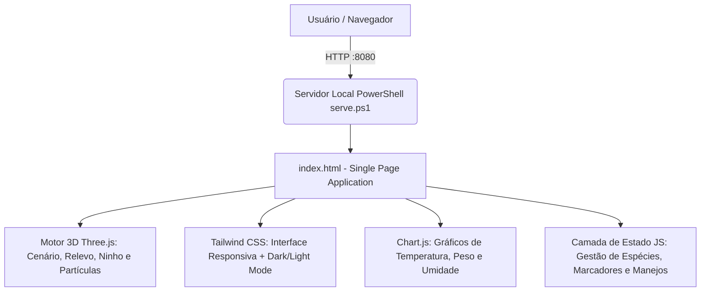

# 🐝 MELIPONA OS — Mapeamento de Voo & Ecologia das Abelhas Nativas
### Ecossistema Digital de Meliponicultura 4.0 | Documentação Completa do Sistema

<p align="center">
  
</p>

<p align="center">
  
  
  
  
</p>

---

## 📌 Sumário Executivo

O **MeliponaOS** é uma Single-Page Application (SPA) progressiva e imersiva para o manejo técnico e conservação das **Abelhas Nativas Sem Ferrão (ASF)** do Brasil. 

O sistema integra:
- **Aba Inicial Institucional/Informativa** (explicação do sistema, benefícios e impacto ambiental).
- **Mapeamento de Voo 3D em Malha Hexagonal ("Hex-Radar")** renderizado com WebGL / Three.js.
- **Telemetria de Campo e Biometria de Colmeias** monitorando temperatura, umidade, peso e frequência acústica.
- **Catálogo de Espécies Nativas Brasileiras** com parâmetros biológicos e medidas de caixas racionais (Padrão INPA).
- **Diário de Manejo Racional** para histórico operacional e auditoria técnica.

---

## 🏛️ Como o Sistema Está Estruturado

A aplicação foi projetada para ser **autocontida, leve e de alta performance**, rodando sem necessidade de etapas pesadas de build (como Webpack ou Vite):



### 📁 Estrutura de Diretórios e Arquivos

```text
ProjetoMeliponicultura/
├── assets/
│   └── sistema-real-meliponaos.png  # Captura real da tela 3D do sistema
├── index.html                       # Núcleo da aplicação (HTML5, Tailwind, Three.js, CSS2D, Chart.js)
├── serve.ps1                        # Servidor HTTP assíncrono nativo em PowerShell (.NET HttpListener)
├── MELIPONA_HEX_ARCHITECTURE.md     # Especificação técnica original da arquitetura HexaBio
└── README.md                        # Guia completo do sistema e documentação
```

---

## 🖥️ Módulos e Abas do Sistema

### 1. 🏠 Aba Inicial: "Início / Sobre" *(Tela Principal Atual)*
- **Objetivo:** Fornecer ao usuário ou pesquisador uma visão clara do que é o sistema antes de entrar nos mapas e dados complexos.
- **Conteúdo:**
  - Apresentação dos pilares do MeliponaOS.
  - Cartões explicativos para cada funcionalidade.
  - Guia de importância das abelhas sem ferrão (polinização florestal, produção de mel medicinal e função como bioindicadores ecológicos).
  - Acesso direto via botões de ação para os módulos operacionais.

### 2. 🗺️ Aba "Hex-Radar 3D" (Mapeamento de Voo & Geografia Real OSM)
- **Geografia Real Integrada (OpenStreetMap / Overpass API):** Ao fixar a 1ª colmeia via GPS, o motor 3D consulta a Overpass API em um raio de ~1km e reconstrói a malha viária urbana (ruas/caminhos em `ShapeGeometry`), os parques/áreas verdes e as edificações reais através de `THREE.ExtrudeGeometry` translúcido (#2A2D35 com arestas iluminadas), transformando o meliponário em um gêmeo digital arquitetônico.
- **Árvores em Áreas Verdes Reais:** A vegetação low-poly deixa de ser aleatória e se concentra prioritariamente nos polígonos de parques e praças mapeados no OSM.
- **Múltiplas Caixas via GPS:** Suporte ao cadastro de vários ninhos com cálculo de distância métrica em relação ao Ponto Zero (1 unidade = 10m reais).
- **Alerta de Competição:** Se os raios de voo de duas caixas se sobrepuserem, as bordas do radar mudam automaticamente para Vermelho/Laranja de Alerta.
- **Hex-Radar Vetorial:** Projeta favos hexagonais pulsantes correspondentes ao raio real de forrageamento:
  - 🌸 **Flores Nativas (Rosa):** Pasto meliponícola monitorado.
  - 💧 **Fontes de Água (Azul):** Bebedouros naturais ou artificiais.
  - 🍯 **Iscas-PET 2L (Roxo):** Localização de garrafas-isca para atração de enxames.
  - ⚠️ **Atenção / Risco (Vermelho):** Aplicações de agrotóxicos ou incidência de forídeos.
- **Controles Interativos:**
  - Alternância de espécies ativas (com redimensionamento imediato do hexágono).
  - Filtro dinâmico por camadas de recursos.
  - Slider temporal das estações (*Verão, Outono, Inverno, Primavera Floral*).
  - Simulação de chuva com desativação do voo das campeiras.
  - Alternador de visão de câmera (Orbital livre, Top-Down / Aérea ou Foco no Ninho).

### 3. 📊 Aba "Meliponário" (Telemetria & Biometria)
- Painéis de acompanhamento em tempo real:
  - **Temperatura de Ninho e Ambiente:** Mostradores circulares com indicação de conforto térmico.
  - **Umidade Relativa Interna:** Sensores de controle para evitar proliferação de fungos.
  - **Evolução de Peso (Célula de Carga):** Curva de acúmulo de mel e pólen ao longo das semanas.
  - **Bioacústica da Colmeia:** Gráfico de espectro sonoro em Hz com detecção do padrão de vibração da rainha.

### 4. 🐝 Aba "Espécies Nativas" (Enciclopédia Visual)
- Fichas técnicas detalhadas das principais abelhas sem ferrão do Brasil:
  - **Mandaçaia (*Melipona quadrifasciata*):** Raio ~1.500 m (~5.84 km²).
  - **Jataí (*Tetragonisca angustula*):** Raio ~500 m (~0.65 km²).
  - **Uruçu-Amarela (*Melipona flavolineata*):** Raio ~2.000 m (~10.39 km²).
  - **Tiúba (*Melipona fasciculata*):** Raio ~2.200 m (~12.57 km²).
  - **Mirim Droryana (*Plebeia droryana*):** Raio ~400 m (~0.41 km²).
- Detalhes de arquitetura de ninho, modelo de caixa recomendado e medidas construtivas em centímetros.

### 5. 📋 Aba "Diário de Manejo"
- Histórico auditável de intervenções:
  - Alimentação energética (xarope 1:1) e proteica (bombom de pólen).
  - Divisão de colônias (métodos 1:1 e 2:1).
  - Colheita de mel com bomba de sucção a vácuo.
  - Controle sanitário contra forídeos (*Pseudohypocera kerteszi*).
- Modal para cadastro rápido de novo manejo em menos de 10 segundos.

---

## ⚙️ Como o Sistema Está Rodando Atualmente

O ambiente está configurado e operando localmente no endereço padrão:

### 1. Servidor Local HTTP Ativo
- **Script:** `serve.ps1`
- **Mecanismo:** Utiliza a classe nativa `.NET System.Net.HttpListener`, dispensando a instalação de Node.js, Apache ou Nginx.
- **Porta:** `8080`
- **URL de Acesso:** [http://localhost:8080/](http://localhost:8080/)
- **Execução em Segundo Plano:** O serviço permanece ativo automaticamente no PowerShell da máquina.

### 2. Sincronização e Versionamento Git
- **Repositório Remoto:** [github.com/MarcosAosf/ProjetoMeliponicultura](https://github.com/MarcosAosf/ProjetoMeliponicultura)
- **Branch Ativa:** `main` (sincronizada e atualizada).
- **Ambiente Git:** MinGit configurado localmente no usuário, integrado à autenticação oficial do GitHub CLI (`gh`).

---

## 🚀 Como Iniciar ou Reiniciar o Serviço Manualmente

Se fechar o terminal ou reiniciar o computador, basta executar:

```powershell
# 1. Abra o PowerShell na raiz do projeto
cd E:\ProjetoMeliponicultura

# 2. Inicie o servidor
powershell -ExecutionPolicy Bypass -File .\serve.ps1
```

O script inicializa o listener HTTP e abre a aplicação automaticamente no navegador padrão em `http://localhost:8080/`.

---

## 🛠️ Tecnologias Utilizadas

| Tecnologia | Finalidade |
| :--- | :--- |
| **HTML5 & Vanilla JavaScript** | Arquitetura SPA desacoplada e sem overhead de compilação |
| **Tailwind CSS (CDN)** | Design responsivo, paleta HexaBio e suporte a Dark/Light Mode |
| **Three.js (r128)** | Renderização de gráficos 3D, relevo de terreno e animação de partículas |
| **CSS2DRenderer** | Rótulos e marcadores HTML sobrepostos com posicionamento 3D no mapa |
| **Chart.js** | Visualização de telemetria histórica e curvas de biomassa |
| **PowerShell + .NET** | Servidor web HTTP local ultra-leve |
| **Git & GitHub CLI** | Controle de versão e publicação remota contínua |

---

<p align="center">
  <strong>MeliponaOS</strong> — Protegendo as abelhas nativas e impulsionando a meliponicultura sustentável. 🐝🍯
</p>
