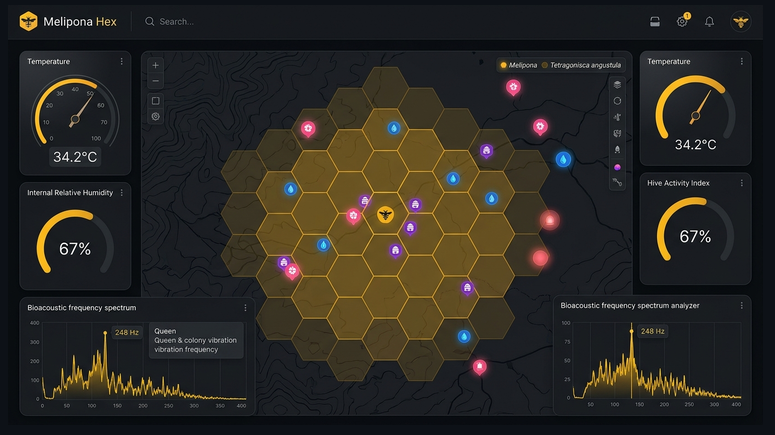
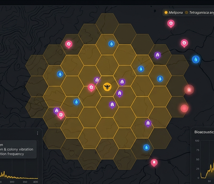

# 🐝 MELIPONA HEX — Ecossistema Digital de Meliponicultura 4.0

<p align="center">
  
</p>

<p align="center">
  <strong>Ecossistema inteligente para criação técnica, telemetria bio-IoT e preservação das Abelhas Nativas Sem Ferrão (ASF).</strong>
</p>

<p align="center">
  
  
  
  
</p>

---

## 🍯 Sobre o Projeto

O **MELIPONA HEX** une o conhecimento biológico ancestral das florestas brasileiras à tecnologia de ponta (Georreferenciamento Vetorial, Telemetria IoT e Simulação de Enxames). 

Dedicado à conservação e manejo racional de espécies como **Mandaçaia**, **Jataí**, **Uruçu**, **Tiúba** e **Mirim**, o ecossistema transforma dados de campo e telemetria em ações assertivas para o meliponicultor.

<p align="center">
  
</p>

---

## ✨ Principais Funcionalidades

### 🌐 1. Hex-Radar Georreferenciado
- **Área de Cobertura Hexagonal:** Abandono de círculos de GPS convencionais por favos hexagonais pulsantes calculados dinamicamente com base no raio real de forrageamento da espécie selecionada.
- **Mapeamento de Bio-Recursos:**
  - 🌸 **Floradas (Néctar e Pólen):** Identificação de pasto meliponícola e rotas de campeiras.
  - 💧 **Fontes de Água Segura:** Mapeamento de bebedouros e áreas limpas.
  - 🍯 **Iscas-PET e Ninhos:** Monitoramento geolocalizado de captura de enxames.
  - ⚠️ **Zonas de Risco:** Alertas contra aplicação de agrotóxicos e controle de forídeos.

### 📊 2. Telemetria Bio-IoT em Tempo Real
- Sensores de temperatura de ninho e ambiente (`34.2 °C`).
- Umidade relativa interna (`67%`).
- Analisador de espectro de frequência bioacústica da colmeia e rainha (`248 Hz`).
- Índice de atividade de fluxo da colmeia (*Hive Activity Index*).

### 📚 3. Catálogo Nativo e Manejo Racional
- Enciclopédia técnica de espécies nativas do Brasil com especificações de caixas racionais (Padrão INPA, Baiano, etc.).
- Registro de manejos rápidos em menos de 10 segundos (alimentação, divisões 1:1 e 2:1, trocas de campeiras e controle sanitário).

---

## 🎨 Design System "HexaBio"

Interface desenvolvida com foco em alta visibilidade para condições de campo e contraste científico:

| Token de Cor | Hex Code | Função |
| :--- | :--- | :--- |
| **Golden Honeycomb** | `#FFC300` | Ações principais, contornos pulsantes do radar e status ativo |
| **Favo Âmbar Dourado** | `#F4B41A` | Gradientes, cartões em destaque e métricas |
| **Dark Canvas** | `#0D0F12` | Fundo principal da aplicação em Dark Mode |
| **Grafite Biológico** | `#14171E` | Superfícies flutuantes e cards de telemetria |
| **Florada Néctar / Pólen** | `#FF5C8A` | Marcadores botânicos |
| **Água Mineral** | `#38BDF8` | Marcadores hídricos |
| **Iscas & Atrativos** | `#A855F7` | Ninhos-isca e pontos de captura |

---

## 🚀 Como Executar o Projeto Localmente

### Pré-requisitos
- Navegador moderno (Google Chrome, Firefox, Safari ou Microsoft Edge).
- PowerShell (Windows) ou qualquer terminal compatível.

### Passos de Instalação e Execução

1. **Clone o repositório:**
   ```bash
   git clone https://github.com/MarcosAosf/ProjetoMeliponicultura.git
   cd ProjetoMeliponicultura
   ```

2. **Inicie o servidor local:**
   - No Windows, execute o script auxiliar:
     ```powershell
     powershell -ExecutionPolicy Bypass -File .\serve.ps1
     ```
   - Ou abra diretamente o arquivo `index.html` em seu navegador.

3. **Acesse no navegador:**
   - Acesse [http://localhost:8080/](http://localhost:8080/) para testar a experiência completa do sistema.

---

## 📂 Estrutura de Arquivos

```text
ProjetoMeliponicultura/
├── assets/
│   ├── dashboard-real.png     # Interface real completa do sistema
│   └── radar-foco.png         # Detalhe real do Hex-Radar com marcadores
├── index.html                 # Aplicação Web SPA e Interface HexaBio
├── MELIPONA_HEX_ARCHITECTURE.md # Documentação técnica detalhada
├── serve.ps1                  # Servidor local HTTP rápido em PowerShell
└── README.md                  # Apresentação do repositório no GitHub
```

---

## 🐝 Espécies Contempladas (Raio de Forrageamento)

| Espécie | Nome Científico | Raio Médio | Área de Cobertura |
| :--- | :--- | :--- | :--- |
| **Jataí** | *Tetragonisca angustula* | ~500 m | ~0.65 km² |
| **Mirim Droryana** | *Plebeia droryana* | ~400 m | ~0.41 km² |
| **Mandaçaia** | *Melipona quadrifasciata* | ~1.500 m | ~5.84 km² |
| **Uruçu Amarela** | *Melipona flavolineata* | ~2.000 m | ~10.39 km² |
| **Tiúba** | *Melipona fasciculata* | ~2.200 m | ~12.57 km² |

---

<p align="center">
  Feito com 💛 e dedicação à preservação das abelhas nativas brasileiras.
</p>
